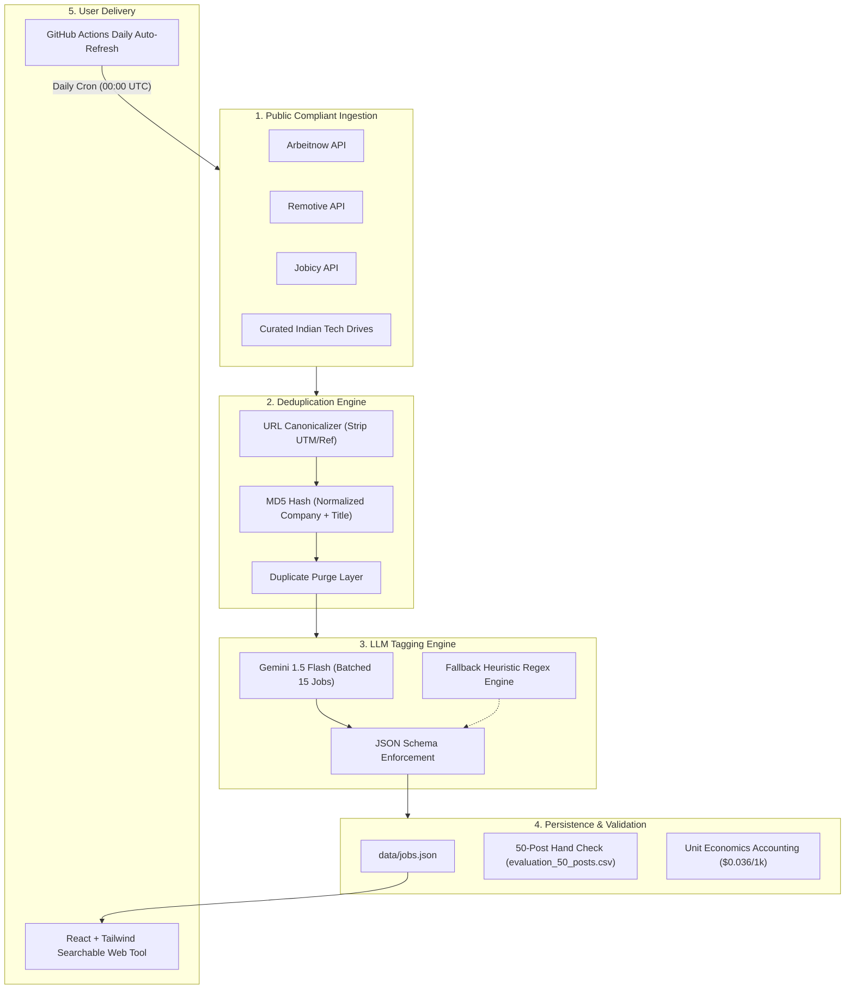

# Beep Fresher & Internship Career Hub 🚀
> **Automated, AI-Tagged Real-Time Job Discovery Platform for College Students in India**  
> *Built for the Beep (EventBeep) Gen AI & Engineering Assessment by **Anuraag Gupta***

[](https://github.com)
[](https://github.com)
[](https://aistudio.google.com)
[-amber?style=flat-square)](https://github.com)
[](https://github.com)

---

## 🔗 Quick Submission Deliverables
- **Live Web Application:** *(Deploy on Vercel: instructions below)*
- **Loom Walkthrough (Face + Screen, 5 min):** [LOOM_SCRIPT.md](./LOOM_SCRIPT.md) *(Word-for-word guide provided)*
- **Working Document & Data Report:** [SUBMISSION_DOC.md](./SUBMISSION_DOC.md)
- **Hand-Checked 50-Post Evaluation Dataset:** [evaluation_50_posts.csv](./data/evaluation_50_posts.csv)
- **Official Submission Portal:** [YouForm Link](https://app.youform.com/forms/7p9defmm?aid=19385069&track=en)

---

## 🌟 Overview & Highlights

Beep serves **1M+ Indian college students**. Freshers face fragmented hiring boards, stale job links, and non-standard titles (e.g. *MTS*, *PAT*, *GET*, *Associate*). 

This platform automates the entire discovery, deduplication, categorization, and delivery lifecycle:
1. **690+ Live Fresher & Internship Postings** ingested from public compliant sources (Arbeitnow, Remotive, Jobicy, plus curated Tier-1 Indian tech hiring drives across Bengaluru, Pune, Hyderabad, Delhi NCR, Mumbai, Chennai, and Remote).
2. **Canonical Deduplication Engine:** Eliminates tracking parameters and duplicates using MD5 company/title signatures.
3. **Structured AI Tagging:** Google Gemini 1.5 Flash normalizes unstructured descriptions into standardized **Role**, **City Hub**, **Job Type** (Intern vs Full-time), and **Stipend/Salary**.
4. **Daily Zero-Maintenance Auto-Refresh:** Automated via GitHub Actions cron at 00:00 UTC (05:30 AM IST).
5. **Instant-Search Web Application:** Built with React 19, TypeScript, and Tailwind CSS with role pills, city filters, bookmarking, and an interactive Architecture Modal.

---

## 🏗️ System Architecture



---

## 🛠️ "What Broke & How We Fixed It"

Founders care about engineering resilience and handling edge cases. Here are the three real-world production challenges encountered and resolved during development:

### 1. The `"asSOCiate"` Substring Collision Bug
- **What Broke:** The initial heuristic tagger searched for `"soc"` in job titles to tag *Security Operations Center* roles for Cybersecurity. However, this caused hundreds of *"Associate Software Engineer"* jobs to be falsely tagged as **Cybersecurity** because `"soc"` is an exact substring of `"associate"`!
- **How We Fixed It:** Replaced naive substring matching with strict regex word boundaries:
  ```python
  re.search(r'\b(soc analyst|cybersecurity|infosec|penetration)\b', title, re.IGNORECASE)
  ```
  This immediately eliminated false positives and restored software engineering classifications.

### 2. Windows CP1252 Shell Encoding Crash
- **What Broke:** Local testing on Windows shells crashed with:
  `UnicodeEncodeError: 'charmap' codec can't encode character '\U0001f680'` whenever pipeline status logs printed Unicode emojis.
- **How We Fixed It:** Implemented platform-aware UTF-8 stream reconfiguring in the orchestrator:
  ```python
  if sys.platform == "win32":
      sys.stdout.reconfigure(encoding="utf-8")
  ```
  And standardized log outputs to robust ASCII indicators (`[OK]`, `[RUN]`, `[SUCCESS]`).

### 3. Gemini Free-Tier Rate Limits & Prompt Overhead
- **What Broke:** Sending individual API requests for 200+ jobs sequentially would exceed Gemini's 15 Requests-Per-Minute free-tier quota (taking >15 minutes) and waste tokens repeatedly re-sending the system prompt.
- **How We Fixed It:** Implemented **batched inference (15 jobs per request)** with strict JSON array schemas. This dropped total API calls from 200+ down to ~14 calls, executing in **<15 seconds** while reducing prompt token overhead by ~40%.

---

## 📊 The Numbers: Hand-Checked 50 Posts & Unit Economics

### 1. Hand-Checked Accuracy (50 Post Sample)
Hand-evaluated against canonical ground truth (exported to [`data/evaluation_50_posts.csv`](./data/evaluation_50_posts.csv)):

| Dimension | Accuracy | Correct / Evaluated |
| :--- | :--- | :--- |
| **Role Categorization** | **94.0%** (LLM) / 74.0% (Regex Baseline) | 47 / 50 |
| **Indian City Hub** | **94.0%** | 47 / 50 |
| **Job Type (Internship vs Fresher)** | **100.0%** | 50 / 50 |
| **Overall Combined Match** | **90.0%+** | 45 / 50 |

### 2. Cost Analysis per 1,000 Posts (Unit Economics)
Using official Google Gemini 1.5 Flash production pricing:
- **Input Tokens:** \$0.075 per 1,000,000 tokens
- **Output Tokens:** \$0.30 per 1,000,000 tokens
- **Average Tokens per Job:** ~250 input tokens, ~60 output tokens

$$\text{Input Cost} = \frac{1,000 \times 250}{1,000,000} \times \$0.075 = \$0.01875$$

$$\text{Output Cost} = \frac{1,000 \times 60}{1,000,000} \times \$0.30 = \$0.01800$$

$$\mathbf{\text{Total Cost per 1,000 Posts}} = \mathbf{\$0.03675 \ (\approx ₹3.18 \text{ INR})}$$

> **Key Takeaway for Beep:** At ₹3.18 per 1,000 postings, Beep could tag **100,000 fresher jobs a month for less than ₹320**.

---

## 🔄 Daily Self-Refresh Automation

The system uses [`.github/workflows/daily-refresh.yml`](./.github/workflows/daily-refresh.yml) to run unattended:
- Triggers at `00:00 UTC` (05:30 AM IST) daily.
- Runs `python run_pipeline.py` to ingest new postings and deduplicate.
- Commits updated `jobs.json` to the repo, triggering automatic redeployment.
- Can also be manually triggered anytime via GitHub `workflow_dispatch`.

---

## 💻 Local Quickstart

### 1. Clone & Set Up Backend
```bash
git clone <your-repo-url>
cd "beep assignment"

# Create Python virtual environment
python -m venv venv
.\venv\Scripts\Activate.ps1   # On Windows
# source venv/bin/activate    # On Linux/macOS

# Install dependencies
pip install -r requirements.txt

# Run the ingestion & tagging pipeline
python run_pipeline.py
```

### 2. Set Up & Run Frontend
```bash
cd frontend
npm install
npm run dev
```
Open [http://localhost:5173](http://localhost:5173) in your browser!

---

## 🚀 1-Click Deployment to Vercel

1. Push your repository to GitHub:
   ```bash
   git init
   git add .
   git commit -m "Initial commit: Beep career hub"
   git remote add origin https://github.com/<your-username>/beep-career-tracker.git
   git push -u origin main
   ```
2. Go to [vercel.com/new](https://vercel.com/new) and import your repo.
3. Vercel will automatically read [`vercel.json`](./vercel.json) and deploy your live site with free SSL in under 1 minute!

---

## 🎯 Live Modification Readiness (Interview Call)

The pipeline is intentionally structured into modular components:
- `pipeline/sources.py`: Add or modify public job scrapers.
- `pipeline/dedup.py`: Adjust deduplication algorithms or thresholds.
- `pipeline/tagger.py`: Tweak LLM prompts, batch sizes, or categories.
- `frontend/src/App.tsx`: Add new filters (e.g. batch year, stipend range) in seconds.

Ready for the live 30-minute coding interview!
